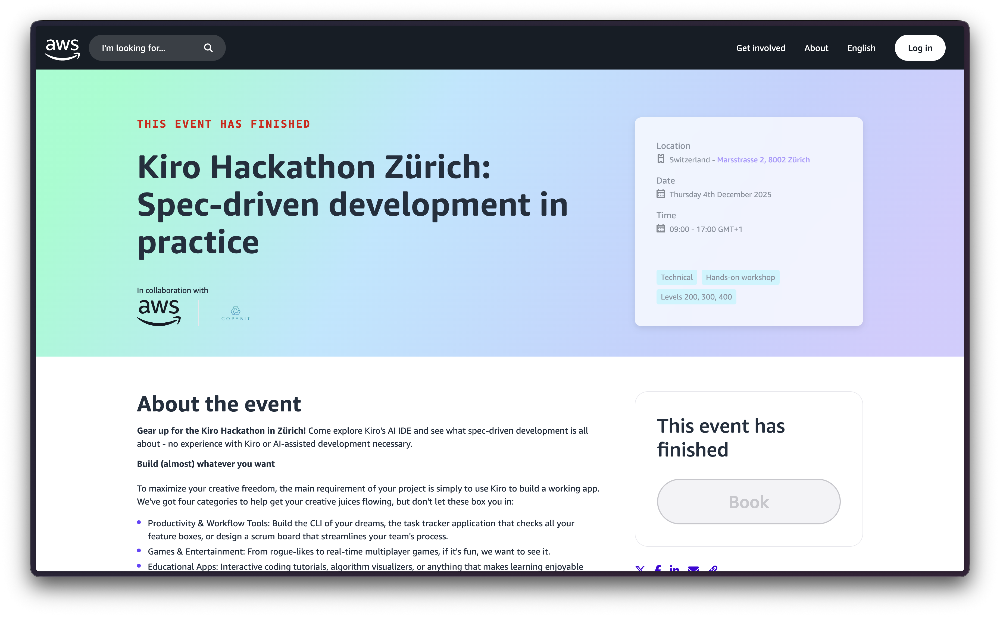
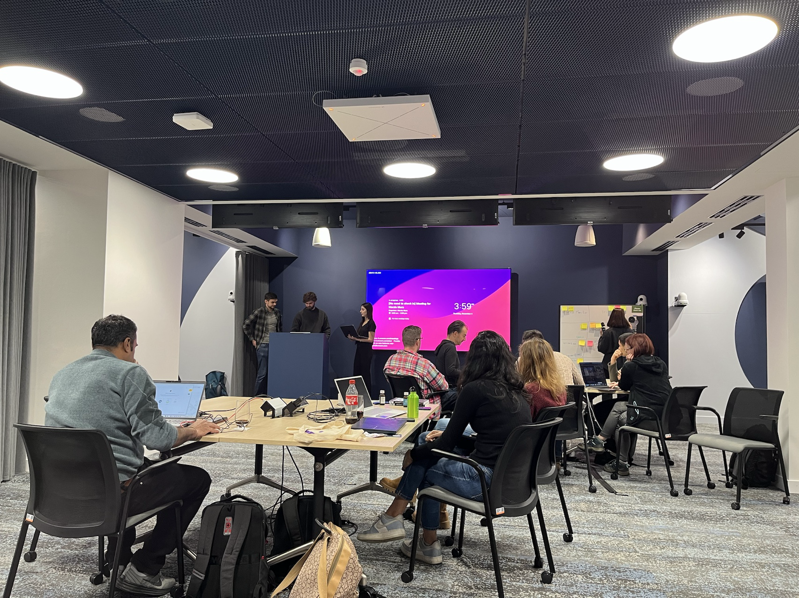

## About the Talk

After our successful webinar with the lovely title `Code Smarter: AWS AI Tools for Modern Development`, AWS has invited me and my employer copebit to co-host a Kiro-focused hackathon in Zürich. All the participants were equipped with Kiro licences in the morning, followed by a short introduction by Ramon Lopez (AWS). Shortly before lunch, I took the stage and held a presentation about my fully AI-written link shortener. Looking back at it, it might look like a small achievement, but I programmed it using the Amazon Q Developer CLI a few weeks prior to the Kiro release and with this in mind, it's a bigger achievement than many had to present at that time. The teams were quite creative in creating apps with Kiro during the event and at the end, all the teams had to present their day's work. The app I liked most was a multiplayer implementation of "Montagsmaler" by fellow students from my former university FHNW.

